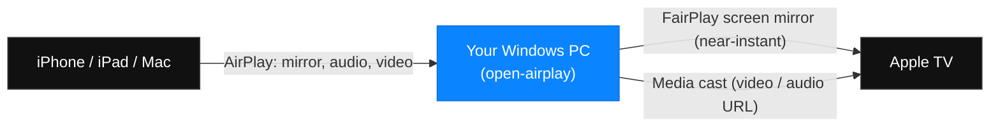
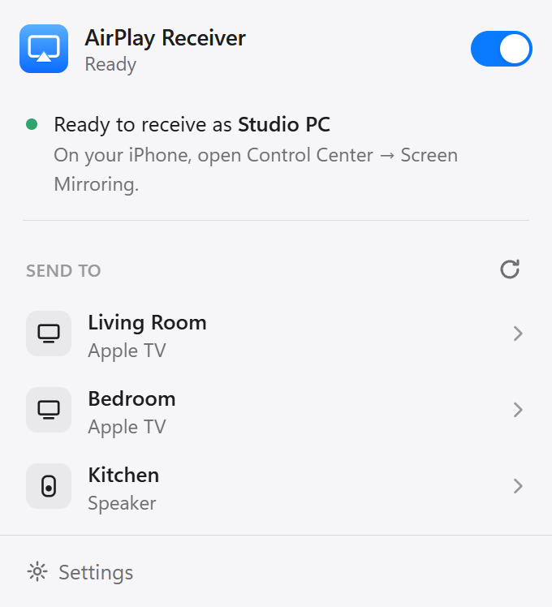
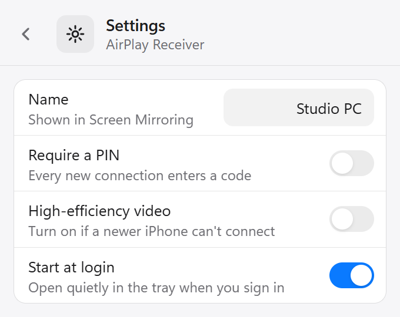
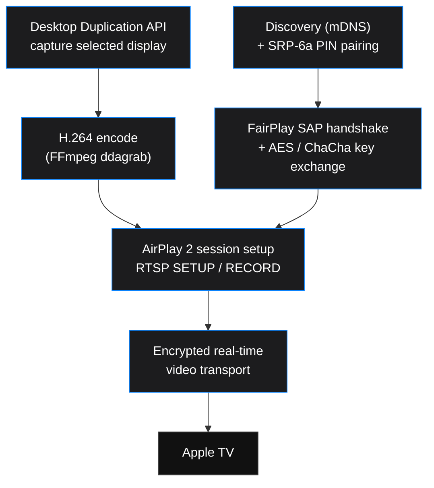

<div align="center">

# open-airplay

### AirPlay for Windows, done right.

Receive AirPlay from your iPhone, iPad, and Mac, and mirror your Windows desktop **to** an Apple TV with real, near-instant FairPlay mirroring. Not a laggy video stream.

[](LICENSE)
[](https://github.com/parsakhaz/open-airplay)


[](https://github.com/parsakhaz/open-airplay/pulls)

<em>Part of a single "Apple interop" app that also does <a href="https://github.com/parsakhaz/open-airdrop-windows">AirDrop on Windows</a> (bonus).</em>

</div>

---

## What it does



| | Direction | Status |
|---|---|---|
| **Receive** | iPhone / iPad / Mac to your PC | Screen mirroring, audio, and video. Working, verified on-device. |
| **Mirror (send)** | your Windows desktop to an Apple TV | Real FairPlay screen mirroring, near-instant latency. Working, verified on an Apple TV 4K. |
| **Cast media** | your PC to an Apple TV | Send a video or audio URL via pyatv. Working. |

The headline feature is **sender-side FairPlay mirroring**: pushing your live desktop to an Apple TV in real time. This is the piece open source had never cracked on Windows. Only paid tools (AirParrot, AirMyPC) did it, because it needs Apple's FairPlay authentication handshake. open-airplay does it in the open.

## Screenshots

<div align="center">

<table>
<tr>
<td width="50%"><br><sub><b>Tray panel</b>: the receiving switch, status, and devices to send to.</sub></td>
<td width="50%"><br><sub><b>Settings</b>: name, PIN, high-efficiency video, and start at login.</sub></td>
</tr>
</table>

<sub>Light and dark aware. The app lives in the tray: one panel that opens above the tray icon, and the mirrored video in its own window.</sub>

</div>

## How the mirror works



- **Receiver**: a supervised [UxPlay](https://github.com/FDH2/UxPlay) engine with built-in device discovery, wrapped in a clean [Tauri](https://tauri.app) app (one tray panel; the mirrored video plays in its own window).
- **Sender (mirroring)**: captures the chosen display via the Windows Desktop Duplication API, encodes H.264 live, runs the AirPlay 2 and FairPlay SAP pairing and handshake, and streams the encrypted mirror in real time. The protocol core is ported from [doubletake](https://github.com/omarroth/doubletake).
- **Sender (media)**: hands a video or audio URL to the receiver's AirPlay playback via [pyatv](https://github.com/postlund/pyatv).

## Quick start

> Requires Windows 10/11, [Go 1.25+](https://go.dev/dl/), and an [FFmpeg](https://www.gyan.dev/ffmpeg/builds/) build with `ddagrab` on your `PATH`. The PC and the receiver must be on the same network.

**Mirror your desktop to an Apple TV**

```console
# See the AirPlay devices on your network
go run ./cmd/open-airplay -list-receivers

# First time: pair (the Apple TV shows a PIN, type it when prompted)
go run ./cmd/open-airplay -receiver "Living Room" -display 0 -pair

# After that, just:
go run ./cmd/open-airplay -receiver "Living Room" -display 0
```

Credentials are saved in Windows Credential Manager, so you pair only once. Press `Ctrl+C` to stop and tear down cleanly. Only ever target a receiver you own.

**Receive AirPlay on your PC**

```console
npm install && npm run dev
```

Then pick your PC from Screen Mirroring or AirPlay on your iPhone or Mac.

## Credits and acknowledgments

This stands on years of open reverse-engineering by others. See the **[reverse-engineering timeline](docs/timeline.html)** and the credits in [open-airdrop-windows](https://github.com/parsakhaz/open-airdrop-windows#credits--acknowledgments) for first-party sources, including the SEEMOO Lab (TU Darmstadt) AWDL and AirPlay research, shairport, RPiPlay and UxPlay, pyatv, and especially **[doubletake](https://github.com/omarroth/doubletake)**, whose FairPlay work makes the mirroring sender possible. Licensed under **GPL-3.0**. We build on doubletake (LGPL-3.0) and UxPlay / RPiPlay (GPL-3.0).

## What's next

- [ ] **Audio for mirroring**: WASAPI capture so the desktop mirror carries sound (currently video-only).
- [ ] **Higher fidelity by default**: native-resolution capture, 60fps, hardware encoding (NVENC / QSV / AMF), and adaptive bitrate tuned to the link.
- [ ] **One-click UI for the mirror**: device picker, PIN flow, and a quality / latency settings panel, folded into the same app as the receiver.
- [ ] **FairPlay provenance review**: document and isolate the FairPlay constants (see doubletake [#59](https://github.com/omarroth/doubletake/issues/59)) before any binary release.
- [ ] **Packaging**: a signed installer and tray app.
- [ ] **AirDrop (bonus)**: the sibling [open-airdrop-windows](https://github.com/parsakhaz/open-airdrop-windows) project. A working path exists via a USB Wi-Fi dongle in WSL2.

## License

[GPL-3.0](LICENSE). Not affiliated with or endorsed by Apple. "AirPlay" and "Apple TV" are trademarks of Apple Inc.
